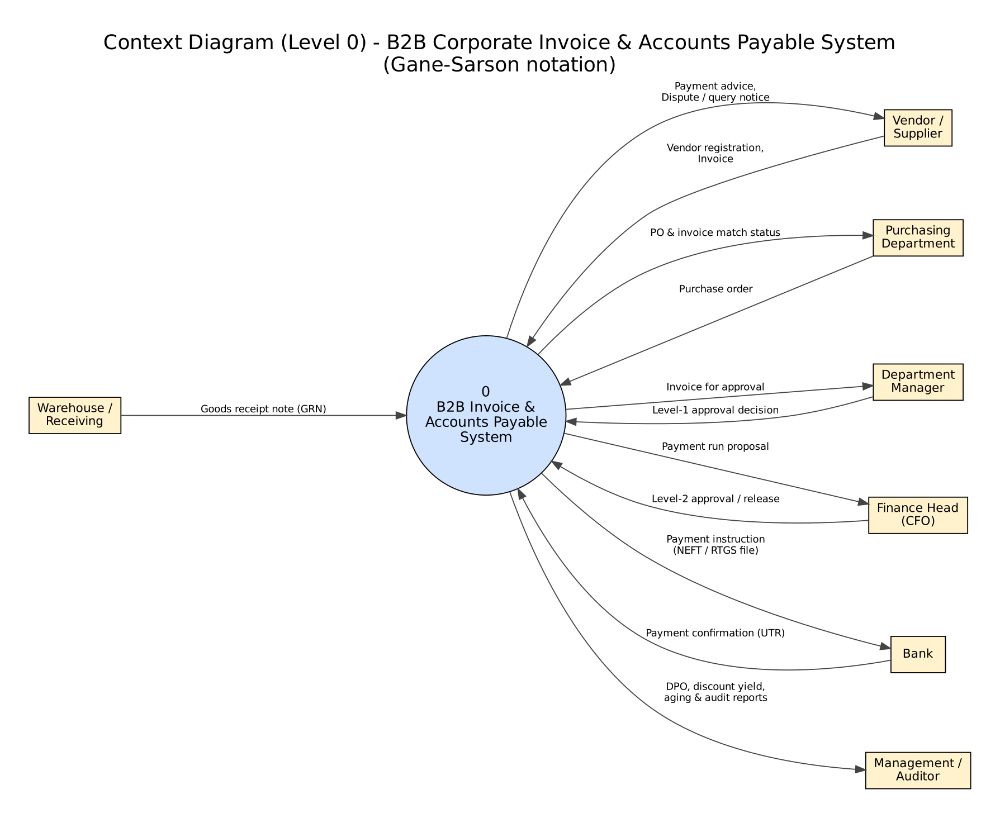
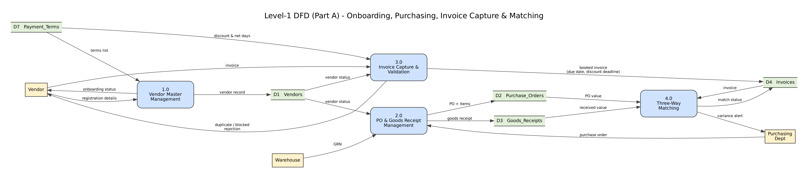
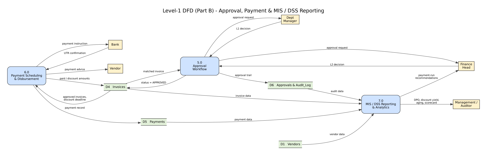
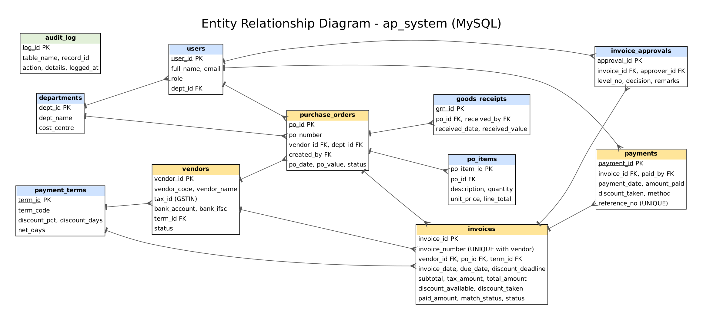

# B2B Corporate Invoice & Accounts Payable System

A MySQL-based **Transaction Processing + Management Information System** for the procure-to-pay cycle:
vendor onboarding → purchase order → goods receipt → invoice capture → **three-way match** → two-level approval → payment,
with management outputs for **Days Payable Outstanding (DPO)** and **Early Discount Yield**.

> TFM Project ID 30 · System type: TPS / MIS (with DSS rules) · Database: MySQL · DFDs: Gane-Sarson (Lucidchart-ready)

**Live dashboard:** after enabling GitHub Pages (see below) → `https://prajwal1712-stack.github.io/B2B-Corporate-Invoice-Accounts-Payable-System/dashboard/`

## Features

- Vendor master with GSTIN, bank details and default payment terms (e.g. *2/10 Net 30*)
- Purchase orders with line items and goods-receipt notes
- Duplicate-invoice and blocked-vendor controls; automatic due date, discount deadline and discount amount
- Three-way match (PO ↔ goods receipt ↔ invoice) with 2 % tolerance
- Two-level approval workflow (department manager → finance head)
- Full or part payments; early-payment discount allowed only inside the window; over-payment blocked
- Audit trail for every invoice booking and payment
- MIS/DSS reports: DPO, discount capture rate, Early Discount Yield, AP aging, vendor scorecard, payment pipeline
- Interactive HTML dashboard with period and vendor filters

## Repository structure

```
ap-invoice-system/
├── sql/
│   ├── 01_schema.sql                # tables, constraints, triggers, procedures, function, views
│   ├── 02_sample_data.sql           # reproducible sample data (48 invoices, 10 vendors, 45 POs)
│   └── 03_analytics_and_tests.sql   # DPO, discount yield, aging, vendor DPO, control tests
├── diagrams/                        # context DFD, Level-1 DFD (A, B), ERD  (PNG + Graphviz .dot sources)
├── dashboard/index.html             # self-contained interactive dashboard (Chart.js via CDN)
├── scripts/
│   ├── setup.sh                     # builds the database and runs the reports
│   └── gen_data.py                  # regenerates 02_sample_data.sql (fixed seed)
├── docs/                            # put the PDF project report here
├── LICENSE
└── README.md
```

## Quick start

Requirements: MySQL 8.0+ (tested on MariaDB 10.11, which is compatible).

```bash
mysql -u root -p < sql/01_schema.sql
mysql -u root -p < sql/02_sample_data.sql      # run on a fresh schema: IDs must start at 1
mysql -u root -p -t < sql/03_analytics_and_tests.sql
```

Or run everything with `./scripts/setup.sh`. In MySQL Workbench use *File → Run SQL Script*.

## Sample results (1 Aug – 31 Oct 2026, synthetic data, ₹)

| KPI | Value |
|---|---|
| Days Payable Outstanding | **31.7 days** |
| Credit purchases | ₹20,519,846 |
| Discount offered / captured / missed | ₹228,148 / ₹117,035 / ₹98,755 |
| Discount capture rate | **51.3 %** |
| Early Discount Yield | **0.81 %** of eligible spend |
| Total outstanding at 14 Nov 2026 | ₹8,513,877 |

**Formulas**

- DPO = (Opening AP + Closing AP) / 2 ÷ Credit purchases × Days in period
- Capture rate = Discount captured ÷ Discount offered
- Early Discount Yield = Discount captured ÷ Discount-eligible spend
- Annualised return of a term = d / (1 − d) × 365 / (net days − discount days) → 2/10 Net 30 = 37.24 %

## Diagrams

**Context DFD**



**Level-1 DFD, part A**



**Level-1 DFD, part B**



**Entity relationship diagram**



## Dashboard

Open `dashboard/index.html` in a browser (internet needed for the Chart.js CDN). The data is a fixed snapshot of the sample database.

**Publish with GitHub Pages:** Settings → Pages → *Deploy from a branch* → `main` / `(root)`.
The dashboard is then served at `/dashboard/`.

## Business rules enforced in the database

| Rule | Mechanism |
|---|---|
| One invoice number per vendor | `UNIQUE (vendor_id, invoice_number)` |
| Blocked vendors cannot be invoiced | trigger `trg_invoice_before_insert` |
| Due date and discount deadline derived from payment term | same trigger |
| Invoice within 2 % of PO value and received value | procedure `sp_three_way_match` |
| Only level-2-approved invoices can be paid | trigger `trg_payment_before_insert` |
| Discount only inside window; no over-payment | same trigger |
| Invoice status follows payments | trigger `trg_payment_after_insert` |

Control tests T1–T5 are included (commented) at the end of `sql/03_analytics_and_tests.sql`.

## Roadmap

Web front end with approval inbox · OCR / GST e-invoice import · ERP and bank-API integration · live dashboard from MySQL · multi-currency and TDS.

## Documentation

Full project report: [`docs/`](docs/) (abstract, feasibility, requirements, DFDs, ERD, data dictionary, testing, controls, viva Q&A).

## License

MIT – see [LICENSE](LICENSE). Sample data is synthetic.
